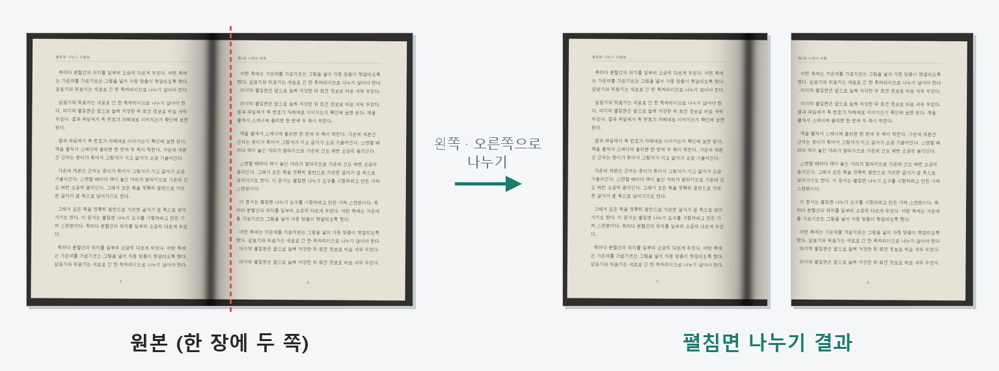
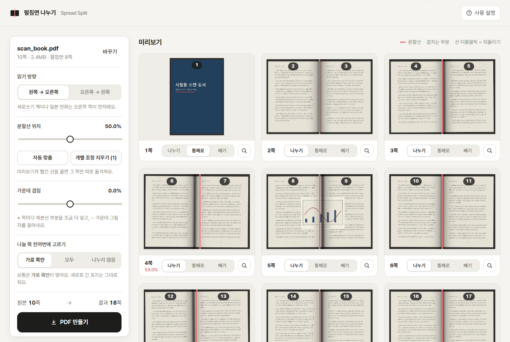

# Spread Split – split two-page scanned PDFs in your browser

[한국어](README.md) · 中文 / 日本語: see the [user guide](https://chaekgalpi.co.kr/apps/spreadsplit/guide.html)

**Use it here:** https://chaekgalpi.co.kr/apps/spreadsplit/?lang=en

The old address https://microhan1.github.io/spread-split/ redirects to the new one.

When you scan a book lying open, each sheet holds two pages. This tool cuts every such page into a left page and a right page and saves a new PDF you can read one page at a time on an e-reader. Everything happens in the browser; the file never leaves your computer.

## Features

- **Nothing to install**: open the page and drop a PDF on it. Works in Chrome, Edge and Whale, and in phone browsers.
- **Files stay on your computer**: reading and cutting both run inside the browser. Nothing is uploaded.
- **Original quality**: images are not re-encoded. Only the visible area (the page box) of each page is halved, and both halves share the same image, so the file barely grows.
- **Gutter alignment**: one slider for the whole book, a draggable split line on each page, and auto-fit that looks for the shadow of the binding.
- **Center overlap**: keep the area around the gutter on both pages (+) or cut the shadow in the middle away (−).
- **Reading order**: left to right, or right to left for vertical-text books and Japanese manga.
- A tall cover page is left whole. Each page can be set to split, whole or skip.
- Interface and user guide in **Korean · English · Chinese (Simplified) · Japanese**. The language follows your browser; change it at the top right. `?lang=en` in the address opens the English screen directly.

## How to use

1. Open https://chaekgalpi.co.kr/apps/spreadsplit/?lang=en (or download `index.html` from this repository and open it in a browser).
2. Drop the scanned PDF on the page.
3. In the preview, check that the red split line sits on the binding. Press **Auto-fit** or drag the line if it does not.
4. Press **Create PDF**. `name_split.pdf` is saved.

Details are in the [user guide](https://chaekgalpi.co.kr/apps/spreadsplit/guide.html#en). No file to try? Use [samples/test_spread_scan.pdf](samples/test_spread_scan.pdf).

## Good to know

- On the Chaekgalpi site the PDF libraries (pdf.js, pdf-lib) come with the page and are stored on your device, so after the first visit it opens offline. The copy in this repository loads them from a CDN the first time; the file itself is still never sent.
- Password-protected PDFs, including ones with only an owner password, cannot be processed.
- The cut-off half is hidden, not removed; it is still inside the file. Do not use this to hide content.
- The OCR text layer stays on both pages, so a search may hit words from the neighbouring page.

## Goes well with

To trim the margins of the split file and enlarge the text, run [TrimPDF](https://github.com/microhan1/TrimPDF) next. The order is split first, then trim. A Windows program that does the same split without a browser: [Two-page Split](https://github.com/microhan1/scan-pdf-split).

Finished the book? Log it on [Chaekgalpi Library](https://chaekgalpi.co.kr/en/tools/spreadsplit?utm_source=github&utm_medium=referral&utm_campaign=tool_cta&utm_content=spreadsplit), a web service for keeping track of the books you read. The tools page is in English; the reading-log service itself is in Korean.

## Feedback

Use **Send feedback** at the bottom of the page or https://chaekgalpi.co.kr/en/tools/spreadsplit#feedback — no sign-in needed. [GitHub Issues](https://github.com/microhan1/spread-split/issues) work too. The link only opens that page; no PDF or image is sent.

## License

[MIT](LICENSE) · Open-source components: [pdf.js](https://github.com/mozilla/pdf.js) (Apache-2.0), [pdf-lib](https://github.com/Hopding/pdf-lib) (MIT), [Pretendard](https://github.com/orioncactus/pretendard) (OFL-1.1)
